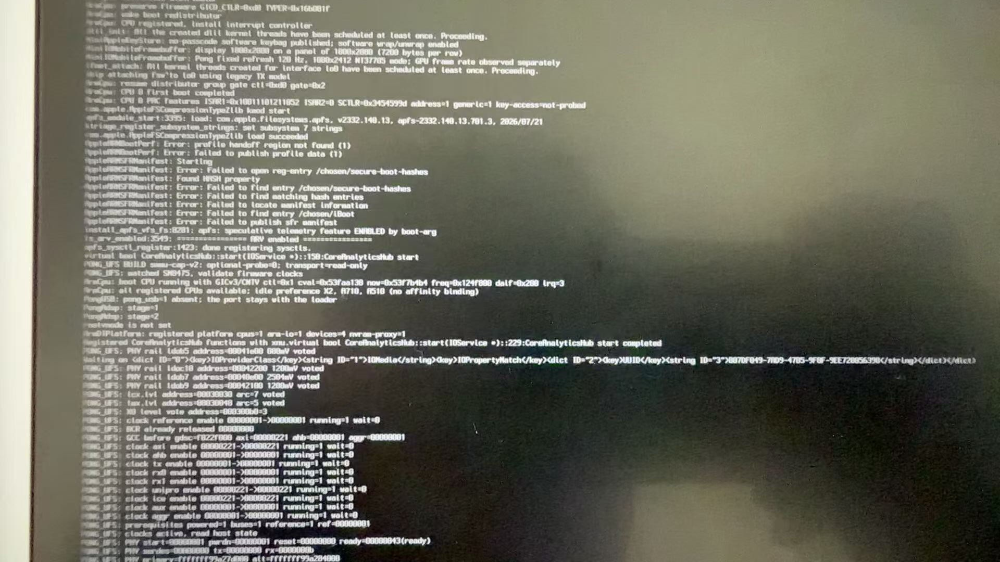
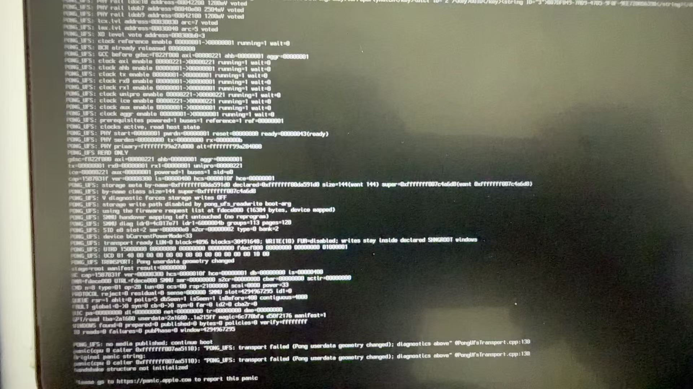

# v134 / 变体 V：UFS 读取突破与当前根布局阻塞

日期：2026-11-23（Asia/Shanghai）。目标：liuqin / SM8475，iPadOS 18.7.10 / Darwin 24.6.0。

## 结论

**本次实机已完成 UFS 初始化命令及实际扇区读取，当前停在驱动沿用 pong 固定 userdata 边界的安全校验。** 未发布根介质、未挂载 APFS、未进入用户态或 SpringBoard。一次成功不等于长期稳定性或完整冷启动覆盖率。

## 构建与启动证据

- 基线：document97/UniXNU-liuqin `fe0e8d790e24120970083e20c1a7d9c86cdbb87c`。
- [CI run 45114535819](https://github.com/Fly116/liuqin-ipados18-ci/actions/runs/45114535819)，成功。
- [CI 提交 4abc00d2dd8b0fc71b19807a180bc582bed1ad16](https://github.com/Fly116/liuqin-ipados18-ci/commit/4abc00d2dd8b0fc71b19807a180bc582bed1ad16)。完整补丁亦见 [本仓库副本](patches/v134-variant-v.patch)。此资料仓库的 drivers 目录并未直接同步为该 CI 补丁状态，复现必须应用 V。
- boot-v134-ufs-v.img：69,009,408 B；SHA256 `bec6810fb3fadeb3512482ec395dadd8ccc33931962853e79739dbe43bac7bbf`。
- 已打 ARMCPU 补丁内核：51,982,336 B；SHA256 `9aaf588d03774eb331dce8b69333f2b9f9a5cf8141ac65d606548008e2a1cf1b`。
- 固定 FD SHA256 `44485ef0ca1e61d714115957cab3e6d5b53746bffae1e1f05090a077d7ab47d5`。
- Cape SHA256 `ce90f88b645ffdcc844ede7b0c57162c082079c4ee162f6b6e262389066b2d31`。
- 设备上仅执行指定序列号的 `fastboot boot`；Sending / Booting 均 OKAY。未 flash、未改 GPT、未写 userdata。
- 最终镜像独立校验通过：boot v4、解压内核槽含固定 FD、尾部 Cape、PONGFAT1、64 MiB FAT 内核与指定 patched kernel 逐字节一致。
- v133 panic PC `0xfffffff007aa7a30` 对应 hostSubmit `stur d0,[x9,#4]`。V 的 [反汇编](evidence/v134-hostsubmit-disassembly.txt) 显示 UTRD / PRDT 已为逐 32 位写；本次越过旧崩溃点。

## 实机照片与关键日志

原始上传附件 SHA256（便于区分原图与旋正副本）：

- clocks 原图：`9660c5dbb5d6a0970f8f8289217e125d1ca94ed670322e22e33e05c91d6f491e`。
- transport 原图：`4f8f21a5511595c41dc5ab14b301a3f07bd87651d455691b21490f278f23c499`。

仓库照片是旋转后的可读副本；下面是人工抄录，不是串口原始日志。未清晰辨认的寄存器值不补写。





```text
PONG_UFS: clock reference enable 00000001->00000001 running=1 wait=0
PONG_UFS: prerequisites powered=1 buses=1 reference=1 ref=00000001
PONG_UFS: PHY start=00000001 pwrdn=00000001 reset=00000000 ready=00000043(ready)
PONG_UFS: V diagnostic forces storage writes OFF
PONG_UFS: storage write path disabled by pong_ufs_readwrite boot-arg
PONG_UFS: device bCurrentPowerMode=33
PONG_UFS: transport ready LUN=0 block=4096 blocks=30491648; WRITE(10) FUA=disabled; writes stay inside declared SHNGROOT windows
PONG_UFS TRANSPORT: Pong userdata geometry changed
GPT/read lba=2a1680 userdata=2a1680..1a215ff ... manifest=1
PONG_UFS: transport failed (Pong userdata geometry changed)
```

`transport ready` 是代码中 query / 必要时 SSU / NOP / TUR / capacity 完成后的日志。后续 GPT 与 userdata 首块读取说明不仅是寄存器假活。此后 panic 是主动诊断错误，不是 UIC 或未对齐异常。

`bCurrentPowerMode=33` 是 `%02x` 打印，即 0x33，不是十进制33。已核对 RootLayout.h：读取首块后先将 manifestStatus=1，仅匹配 `SHNGROOT` magic 才进入状态2及后续校验。因此本次 `manifest=1` 表示 userdata 分区首块未匹配该 raw SHNGROOT 标识；这不证明 Android 文件系统内没有文件根镜像，也不证明已有可用根布局。修正边界后仍须处理这一布局不匹配，不能只删校验就宣称可挂载。

## 当前阻塞的准确位置

NativeUfs/PongUfsTransport.cpp 仍要求：

```cpp
kPongUserdataFirst4k = 0x413248ULL;
kPongUserdataLast4k  = 0x75a40eaULL;
// findRootLayout 后
if (layout.userdataFirst != kPongUserdataFirst4k ||
    layout.userdataLast != kPongUserdataLast4k ||
    layout.userdataLast >= gHost.blocks)
  return transportFailure("Pong userdata geometry changed");
```

本次 GPT 读到的 liuqin 边界与 pong 不同，命中拒绝条件。**不能通过改 GPT 来迎合手机常量，也不能直接删去所有边界和 manifest 验证。** 下一轮需先与设备实际 GPT / 备份 / 根布局方案对照，保留容量、溢出、窗口不重叠与分区界限检查。

## 本次补丁做了什么、没有证明什么

- 修复 O 的 volatile 描述符组合遗漏。
- CBCR bit0=ENABLE 应置1；bit31=CLK_OFF。GDSC SW_COLLAPSE bit0，旧bit30错误。
- 按 Linux 分支类型处理 HWCG / NoC FSM；TX/RX symbol clocks 不在 PHY 点火前作 CLK_OFF 硬门槛。
- 移除 offset0 全字 scratch 回显测试，采用已核对的 SM8475 v6 布局、PHY reset、HS-B补项；修正 Available TX MIB。
- 错误码寄存器只读，不再假设 0x38..0x48 全部 W1C；UIC 未就绪则超时退出。
- 内核强制 `gHost.writable=false`，即使旧 boot args 带 `pong_ufs_readwrite=1` 也拒写。

**本次没有 `SM8475 v6 PHY init` / `PHY v6 ...` 冷初始化分支日志。** 观察到的是进入驱动时 PCS READY 已置位、随后接管读取成功。合理解释是纠正时钟后保住固件现成链路，但不能把该解释升级为“完整 PHY 冷启已上机验证”或“固件关电根因已证实”。

## 下一步与安全边界

1. 只读核对实际 GPT、根镜像部署状态与 RootLayout/manifest 语义。
2. 最小适配 liuqin 边界校验和必要根布局逻辑，保留本次已工作的读取路径与强制禁写。
3. 验证根介质发布 / APFS 读取挂载，再讨论用户态。

本报告时点下一版尚未构建；不执行分区或 userdata 写入。上游对照见 [同步报告](upstream-storage-sync-2026-11-23.md)，构建细节见 [复核记录](v134-build-review-2026-11-23.md)。
